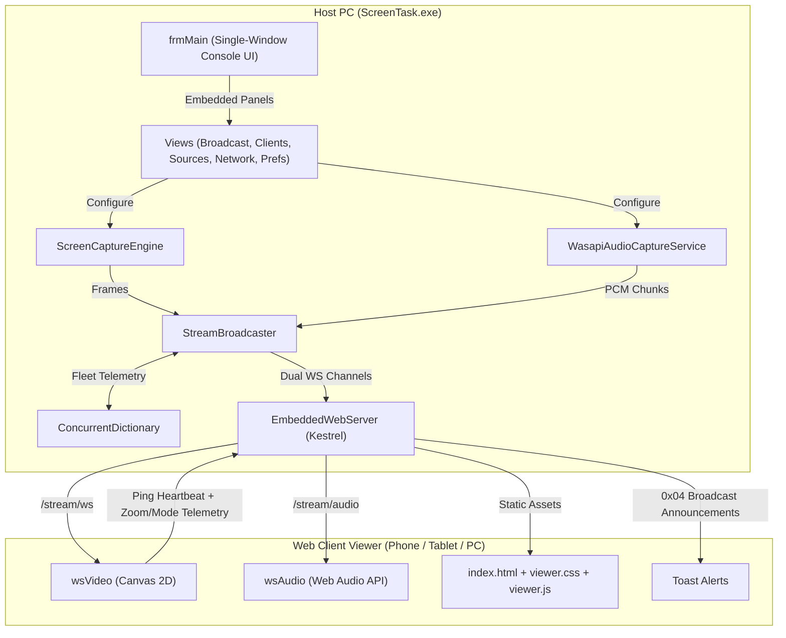

# Project Overview

ScreenTask 2.0 is a free, open-source, portable Windows desktop application built with modern
.NET (targeting .NET 9.0 Windows desktop with C# 13) that provides instant, zero-configuration
screen and audio sharing over local Wi-Fi, Ethernet LAN, or mobile hotspots without requiring
internet access. It features low-latency (<50ms) dual-channel binary WebSocket streaming, NAudio 3
WASAPI system audio capture, monitor and individual application window sharing, in-memory zero-disk
compression, PIN session protection, QR code pairing, and a responsive HTML5/CSS3/ES6 web client
supporting iOS Safari, Android Chrome, and desktop browsers.

## Repository Structure

* `.github/` - Community health and project funding configuration files.
* `ScreenTask/` - Main Windows Forms desktop host application and embedded Kestrel web server.
  * `Core/` - Core domain engines for audio, screen capture, networking, and streaming.
    * `Audio/` - NAudio 3 WASAPI audio capture service for loopback and microphone devices.
    * `Capture/` - Capture abstraction, Win32 GDI interop, and capture timer engine.
    * `Network/` - Network adapter enumeration, firewall rule helpers, and QR code generation.
    * `Streaming/` - In-memory JPEG encoding, frame-dropping protection, WebSocket broadcaster, and `ViewerSession` fleet telemetry.
  * `UI/` - Windows Forms single-window host UI and custom components.
    * `FeedbackForm.cs` - In-app bug report and feature request dialog with auto-diagnostics, GitHub Issues integration, and email/clipboard fallback.
    * `MonitorPreview.cs` - Native confidence monitor panel with live overlay indicators.
    * `SourceCard.cs` - Visual source selection card for displays and application windows.
    * `SourceSelectionForm.cs` - On-demand visual thumbnail picker dialog for displays and application windows.
  * `WebServer/` - Embedded ASP.NET Core server, REST endpoints, and static web viewer assets.
* `ScreenTask.Tests/` - Automated xUnit test suite containing unit, integration, and UI tests.
  * `Core/` - Unit tests for settings, capture clipping, adapters, QR codes, and audio.
  * `Integration/` - Integration tests for embedded Kestrel server, WebSockets, and static assets.
  * `UI/` - STA-threaded Windows Forms UI validation tests for forms, views, controls, and events.
* `ScreenTask.sln` - Visual Studio solution file uniting the application and test projects.

## Build & Development Commands

### Install & Restore
```powershell
dotnet restore
```

### Build
```powershell
# Debug build
dotnet build

# Release build (strict zero warnings/errors)
dotnet build -c Release
```

### Test
```powershell
# Run all unit, integration, and UI tests
dotnet test

# Run tests without rebuilding (useful when ScreenTask.exe is running)
dotnet test ScreenTask.Tests/ScreenTask.Tests.csproj --no-build

# Run a specific test class or method
dotnet test --filter "FullyQualifiedName~EmbeddedWebServerIntegrationTests"
dotnet test --filter "FullyQualifiedName~MainFormUiTests"
```

### Lint & Format
```powershell
# Verify formatting without modifying files
dotnet format --verify-no-changes

# Auto-format C# source files
dotnet format
```

### Static Syntax Check (Web Assets)
```powershell
# Validate JavaScript syntax for the web client viewer
node -c ScreenTask/WebServer/viewer.js
```

### Run
```powershell
# Launch the desktop application
dotnet run --project ScreenTask/ScreenTask.csproj
```

### Publish & Deploy
```powershell
# Publish standalone single-file executable for Windows x64 (self-contained .NET 9)
dotnet publish ScreenTask/ScreenTask.csproj -c Release -r win-x64 --self-contained true `
  -p:PublishSingleFile=true -p:IncludeNativeLibrariesForSelfExtract=true

# Publish lightweight framework-dependent portable build for Windows x64
dotnet publish ScreenTask/ScreenTask.csproj -c Release -r win-x64 --self-contained false `
  -p:PublishSingleFile=true
```

## Code Style & Conventions

* **Language Version**: C# 13 running on `.NET 9.0-windows10.0.19041.0`.
* **Nullable Reference Types**: Enabled globally (`<Nullable>enable</Nullable>`). No nullable
  suppression (`!`) without documented justification.
* **Naming Conventions**:
  * PascalCase for types, methods, public properties, and events (`ScreenCaptureEngine`).
  * `I` prefix for interfaces (`ICaptureSource`).
  * `_camelCase` with leading underscore for private fields (`_broadcaster`, `_captureEngine`).
  * `camelCase` for local variables and parameters.
  * WinForms event handlers use `controlName_EventName` (`btnStartServer_Click`).
* **Web Viewer Code**:
  * Pure ES6+ JavaScript wrapped in IIFE (`viewer.js`), standard CSS3 (`viewer.css`).
  * Zero npm/webpack build step required; assets are compiled into the executable as `<EmbeddedResource>` and served directly from memory.
  * Always verify syntax with `node -c ScreenTask/WebServer/viewer.js` after edits.
* **Commit Message Format**: Follow Conventional Commits:
  * Format: `<type>(<scope>): <short description>`
  * Types: `feat`, `fix`, `refactor`, `test`, `docs`, `style`, `chore`
  * Scopes: `core`, `audio`, `capture`, `network`, `web`, `ui`, `tests`
  * Example: `feat(audio): migrate to NAudio 3 WasapiRecorder and add dedicated audio channel`

## Architecture Notes



### Component Breakdown & Data Flow
1. **Compact 3-Tab Native UI (`frmMain`)**: Unified into a native Windows Forms `TabControl`
   with 3 organized tabs (`Broadcast`, `Connected Viewers`, `Settings & Logs`) built using native
   `GroupBox` and `TableLayoutPanel` containers, classic Windows Light theme styling, opt-in
   audio streaming (muted by default), inline QR code pairing on the main Broadcast tab, and an
   on-demand visual source picker dialog (`SourceSelectionForm`).
2. **ScreenCaptureEngine**: Driven by an asynchronous high-resolution timer loop. Captures frames
   from `ICaptureSource` (`ScreenCaptureSource` or `WindowCaptureSource`) using GDI32 BitBlt or
   PrintWindow, conditionally draws the hardware mouse cursor, and pushes bitmaps to broadcaster.
3. **WasapiAudioCaptureService**: Captures system output loopback or microphone audio via modern
   NAudio 3 `WasapiRecorderBuilder`. Converts multi-channel audio to normalized PCM, calculates
   real-time VU levels for UI metering, and dispatches buffers to `StreamBroadcaster`.
4. **StreamBroadcaster**: Encodes incoming bitmaps into memory-buffered JPEGs using
   `System.Drawing.Imaging`. Implements drop-frame protection for slow network clients and pushes
   binary packets over `/stream/ws` (video) and `/stream/audio` (audio). Manages real-time viewer
   sessions (`ViewerSession`), measuring fleet RTT ping latency, handling individual audio muting,
   and dispatching broadcast announcements.
5. **EmbeddedWebServer**: In-process ASP.NET Core Kestrel instance. Hosts static viewer assets,
   serves REST endpoints (`/api/status`, `/api/auth`, `/api/qrcode`), and handles WebSocket
   connections with optional PIN session authentication.
6. **Web Viewer**: Pure HTML5/CSS3/JS client (`viewer.js`). Renders video onto `<canvas>`, streams audio
   through the Web Audio API with a jitter buffer, supports double-tap zoom, pinch-to-zoom (up to 5x),
   simulated iOS fullscreen, ping/pong heartbeats, and on-screen broadcast alert toasts.

## Testing Strategy

1. **Unit Tests** (`ScreenTask.Tests/Core/`):
   * Validate standalone algorithms: `AppSettings` XML serialization, `CaptureSource` coordinate
     bounding, `NetworkHelper` adapter and loopback filtering, `QrCodeHelper` PNG generation,
     and `StreamBroadcaster` client tracking.
2. **Integration Tests** (`ScreenTask.Tests/Integration/`):
   * Spins up real embedded Kestrel web servers on local loopback test ports.
   * Tests HTTP GET for `/`, `/viewer.css`, `/viewer.js`, `/api/status`, `/api/qrcode`.
   * Verifies WebSocket connections, binary frame delivery, and audio PCM packets.
   * Tests PIN authorization enforcement, invalid attempts, and dynamic client disconnection.
   * Automatically validates `viewer.js` syntax via `node -c -` through standard input.
3. **UI Tests** (`ScreenTask.Tests/UI/`):
   * Runs forms (`frmMain`, `SourceSelectionForm`, `FeedbackForm`) inside STA threads.
   * Validates control layouts, refresh buttons, and deadlock-free disposal.
4. **Local Execution**:
   * Run `dotnet test` from repository root.
5. **CI & Release Execution**:
   * Automated CI workflow (`.github/workflows/ci.yml`) targeting `windows-latest` on pushes and pull requests to `master`.
   * Automated GitHub Release workflow (`.github/workflows/release.yml`) triggered on `v*` tags (`v2.0`), publishing `ScreenTask-<tag>-win-x64-standalone.exe`, `ScreenTask-<tag>-win-x64-portable.zip`, and `SHA256SUMS.txt`.

## Security & Compliance

* **Secrets & Credentials**:
  * No secrets, tokens, or external API keys are required or stored in the codebase.
  * PIN authentication uses in-memory comparison over `/api/auth` without database persistence.
* **Network Exposure**:
  * Server binds strictly to the user-selected local network adapter or loopback (`127.0.0.1`).
  * Unauthenticated WebSocket attempts are terminated with `PolicyViolation` (1008) when PIN
    protection is enabled.
* **Native Interop & Memory**:
  * Win32 API calls (`gdi32.dll`, `user32.dll`, `dwmapi.dll`) use safe P/Invoke declarations.
  * All device contexts and graphics handles (`HDC`, `HBITMAP`) are released in `finally` blocks.
  * Frame buffers use in-memory streams; zero media files are written to physical disk.
* **Licensing**:
  * Licensed under the GNU General Public License v3.0 (GPLv3).
  * Any new dependencies or contributions must remain GPLv3 compatible.

## Agent Guardrails

* **Restricted Files (Do Not Modify Without User Request)**:
  * Solution file `ScreenTask.sln` structure unless explicitly adding a project.
  * Visual Studio metadata (`.vs/`, `*.user`, `*.suo`).
  * Binary icons (`ScreenTask/file_icon.ico`, `ScreenTask/screenicon.ico`).
  * Copyright headers and authorship notes in `README.md` and source files.
* **Audio Library APIs**:
  * Do NOT use deprecated NAudio classes (`WasapiCapture`, `WasapiLoopbackCapture`).
  * Always use modern NAudio 3 APIs: `WasapiRecorderBuilder`, `WasapiRecorder`, `WasapiPlayer`.
* **UI Threading**:
  * Never call blocking audio operations (`Dispose()`, `Join()`, `Stop()`) synchronously on the
    Windows Forms UI thread. Perform audio cleanup on background tasks or asynchronous paths.
* **Web Client Assets**:
  * Static web viewer assets in `ScreenTask/WebServer/` (`index.html`, `viewer.css`, `viewer.js`,
    `favicon.svg`, `buymeacoffee.png`) are embedded into the assembly as `<EmbeddedResource>` and
    served from memory by `EmbeddedWebServer`. Rebuild the project after editing web assets.

## Extensibility Hooks

1. **Custom Capture Sources**:
   * Implement `ScreenTask.Core.Capture.ICaptureSource` (`CaptureFrame()`, `DisplayName`).
   * Can be used to add DirectX Desktop Duplication (DXGI), Windows.Graphics.Capture, or webcam
     overlays.
2. **Audio Processing**:
   * `WasapiAudioCaptureService` exposes `AudioDataAvailable` and `AudioLevelChanged`.
   * Hook into this pipeline to inject noise suppression, audio filters, or Opus compression.
3. **HTTP & WebSocket Endpoints**:
   * Register new endpoints inside `EmbeddedWebServer.MapEndpoints()`.
   * Additional REST routes or streaming protocols can be mounted directly on Kestrel.
4. **Persistent Settings**:
   * Add properties to `ScreenTask.AppSettings`. Settings are automatically serialized to XML in
     `%APPDATA%\ScreenTask\settings.xml`.

## Further Reading

* [README.md](README.md) - End-user setup guide, feature overview, and version comparison.
* [Official Project Website](https://screentask.eslamx.com/) - Landing page, user tutorials, and downloads.
* [ScreenTask 2.0 Release Hub](https://screentask.eslamx.com/v2) - Feature deep-dive and v1.x vs v2.0 comparison.
* [Legacy v1.2 Classic Archive](https://screentask.eslamx.com/v1) - Preserved downloads for Windows Vista/7/8 and 32-bit systems.
* > TODO: Create `docs/ARCH.md` with binary WebSocket frame header specifications.
* > TODO: Create `docs/CONTRIBUTING.md` with guidelines for pull requests and code review.
